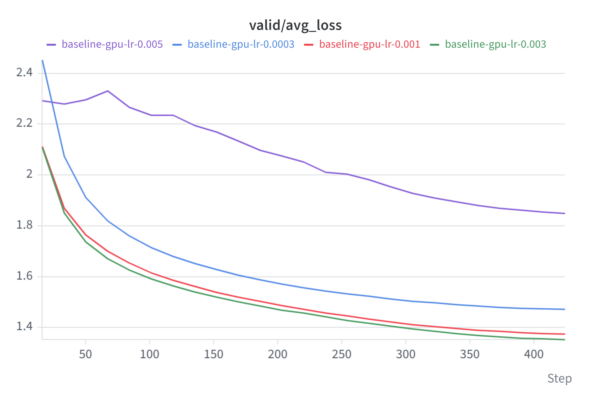

# Transformer Language Modeling from Scratch

> **Part 1 of 2.** This repository builds the model and training pipeline. The [systems project](https://github.com/ChuaoD/cs336-assignment2) (Part 2) reuses these modules and scales them to an 8.1B-parameter, 32K-context model on two B200 GPUs with custom Triton kernels and FSDP.

I built and trained a decoder-only Transformer language model from scratch, implementing the pipeline from raw text and byte-pair encoding to optimization, validation, and text generation. Based on Stanford CS336 Spring 2026 Assignment 1, this project demonstrates how I translate a mathematical specification into working code, train it on GPUs, and use experiments to tune its behavior.

- **Build:** implement a byte-level BPE tokenizer, causal multi-head attention, rotary positional embeddings, RMSNorm, SwiGLU, and a custom AdamW optimizer using PyTorch tensor operations and autograd.
- **Train:** assemble data preparation, memory-mapped batch loading, gradient clipping, learning-rate scheduling, checkpointing, and experiment tracking into a working training pipeline on NVIDIA A100 GPUs.
- **Tune and evaluate:** run a four-setting learning-rate sweep with fixed training seeds and independent, reusable validation batches. Select `0.003` as the best observed setting, achieving **1.3529 validation cross-entropy / 3.8686 validation perplexity**.

The [experiment results](#learning-rate-experiments) document the sweep, the model-selection decision, and the limits of the comparison.

## My contributions

The assignment supplies the architecture specification and model dimensions, starter infrastructure, reference tests, and a pretokenization chunk-boundary helper. My contribution is implementing and integrating the components, debugging the training pipeline, and investigating learning-rate sensitivity through experiments. The model configuration is documented below to make those experiments interpretable and reproducible.

| Area | Implementation | Implementation details |
| --- | --- | --- |
| Tokenizer training | Byte-level BPE, special-token handling, deterministic merge tie-breaking, multiprocessing-based pretokenization | Track which tokens contain each pair so merges update affected token counts instead of rebuilding every count |
| Tokenization and data preparation | Encoding/decoding, cached pretoken encodings, incremental corpus encoding, binary token-ID files | Reuse repeated encodings; preserve document separators across input chunks; store the 10,000-token vocabulary's IDs as `uint16` |
| Transformer | Custom linear layers and embeddings, RMSNorm, SwiGLU, rotary position embeddings, causal multi-head attention, residual blocks, language-model head | Express the architecture directly through tensor operations; apply causal masking and pre-normalization explicitly |
| Optimization | AdamW, warmup and cosine decay, gradient clipping, cross-entropy | Implement moment estimates, bias correction, and decoupled weight decay; stabilize softmax and loss calculations by shifting logits |
| Training infrastructure | Memory-mapped datasets, sampled batches, configurable training, validation, checkpoint saving/loading, W&B logging | Keep data on disk until sampled; retain model and optimizer state; save the best validation checkpoint |
| Experiments and diagnostics | Slurm/W&B sweep orchestration, a fixed-minibatch overfitting script, seed controls, validation-sampling checks | Separate model debugging from full training and separate validation randomness from training randomness |
| Generation | Temperature scaling, nucleus sampling, context-window truncation, end-of-text stopping | Generate from a saved checkpoint with explicit sampling controls |

The implementation uses PyTorch for tensor execution, automatic differentiation, and module/optimizer interfaces. The architecture and optimizer update equations are implemented in this repository.

## Engineering decisions and tradeoffs

**Incremental BPE updates.** The trainer maintains pair frequencies and an index of affected pretokens. After a merge, it removes the old contributions and adds the merged token's contributions. Pair selection still scans the pair table for the maximum, leaving a concrete next target for profiling. Parallel preprocessing and incremental updates are implemented; a measured speedup against a naive baseline is not yet reported.

**Memory-conscious data handling.** Corpus encoding reads text incrementally and writes token IDs to disk. Training uses NumPy memory maps and materializes sampled batches. The encoding cache is capped at 100,000 pretokens to limit growth. Encoding chunks follow special-token boundaries, so an unusually long document can still enlarge the input buffer.

**Controlled comparisons.** Fresh training runs seed PyTorch and NumPy. A separate NumPy generator selects validation batches once, stores them on CPU, and reuses them at every evaluation. Each validation batch moves to the GPU only when needed. This keeps evaluation from consuming the random sequence used for training samples.

**Practical experiment execution.** The Slurm launcher starts four independent single-GPU W&B agents, captures separate logs, and propagates agent failures. Each experiment trains its own model. Model and optimizer checkpoints support continuation, although RNG state is not saved, so resuming does not reproduce an uninterrupted run exactly.

## Learning-rate experiments

### Selecting the learning rate

I compared four peak learning rates spanning `0.0003` to `0.005`, with fixed seeds and reusable validation batches. The command-line override changes the cosine schedule's peak learning rate and keeps its minimum at one tenth of the peak.

Each exported series contains 25 evaluations. The last evaluation is also the lowest recorded loss for every setting:

| Peak learning rate | Final validation cross-entropy | Validation perplexity |
| ---: | ---: | ---: |
| 0.0003 | 1.4724 | 4.3595 |
| 0.001 | 1.3752 | 3.9557 |
| **0.003** | **1.3529** | **3.8686** |
| 0.005 | 1.8494 | 6.3558 |

Source: [validation-loss CSV](sweep_lr/new_valid_loss_0.0003_0.005.csv), final exported W&B step `424`. Perplexity is calculated as `exp(cross-entropy)` from the unrounded loss values.



**Decision.** Select the run at `0.003` for checkpoint evaluation and text generation. Its final loss is `1.3528902233`, and it has lower validation loss than `0.001` at all 25 evaluation points. Compared with the `0.001` baseline, final cross-entropy is lower by `0.0223` nats per token, corresponding to approximately **2.20% lower validation perplexity**.

**Interpretation.** The smallest rate converges more slowly, while `0.005` remains substantially worse within the observed budget despite continuing to improve. The experiment shows sensitivity to learning-rate choice and identifies the best observed setting among these four candidates. It does not establish a globally optimal rate or a statistically significant advantage across random seeds. Points along one learning curve are not independent replicate runs.

**Evaluation scope.** These are losses on the sampled validation batches used for model selection, not full-validation-corpus or independent test-set estimates. The export contains no run IDs, hardware timings, or saved configurations; preserve those W&B records alongside the selected checkpoint. Its `Step` column is a logging index. Under the current script and configuration, indices `16, 33, ..., 424` correspond to evaluations at optimizer iterations `800, 1600, ..., 20000`.

### Training and evaluation configuration

The current [configuration](configs.json) defines the experiment protocol:

| Setting | Value |
| --- | --- |
| Dataset | TinyStories, training and validation token-ID files |
| Vocabulary / context length | 10,000 / 256 |
| Layers / attention heads | 4 / 16 |
| Model width / feed-forward width | 512 / 1,344 |
| Trainable parameters | 22,696,448; separate input and output embedding matrices |
| Batch size / optimizer steps | 64 / 20,000 |
| Training-token presentations | `64 × 256 × 20,000 = 327,680,000` |
| AdamW betas / epsilon / weight decay | `(0.9, 0.95)` / `1e-6` / `0.01` |
| Warmup / cosine schedule endpoint | 400 / 20,000 iterations |
| Gradient clipping | Maximum global L2 norm of 1.0 |
| Evaluation | Every 800 steps on 20 fixed batches |
| Training / evaluation seed | 42 / 123 |

The token budget counts sampled token presentations, which can include repeated positions. It is not the number of unique corpus tokens. Seed controls support comparisons between fresh runs; bitwise reproducibility across GPU environments is not guaranteed.

## Reproduce the workflow

Run commands from the repository root. Python 3.12 or 3.13 and `uv` are required. GPU training also requires a CUDA-capable PyTorch installation.

### 1. Install dependencies

```bash
uv sync
```

### 2. Prepare TinyStories

Download the TinyStories training and validation text using the commands in [data_access.md](data_access.md#download-data). The experiments here use TinyStories; OpenWebText is not required.

Train the tokenizer on training text only:

```bash
uv run python -m cs336_basics.train_tokenizer --input_path data/TinyStoriesV2-GPT4-train.txt --vocab_size 10000 --output_dir TinyStories
```

Encode both splits with the same tokenizer:

```bash
uv run python -m cs336_basics.encode_data --input_path data/TinyStoriesV2-GPT4-train.txt --vocab_path TinyStories/vocab.pkl --merges_path TinyStories/merges.pkl --output_path TinyStories/training_ids.bin
uv run python -m cs336_basics.encode_data --input_path data/TinyStoriesV2-GPT4-valid.txt --vocab_path TinyStories/vocab.pkl --merges_path TinyStories/merges.pkl --output_path TinyStories/valid_ids.bin
```

If these token-ID files already exist, reuse them with their original tokenizer artifacts. Retraining a tokenizer can change the mapping from text to IDs.

### 3. Configure and train

In [configs.json](configs.json), set dataset paths and `checkpoint.output_dir` for your machine. The checked-in `checkpoint.output_dir` is a relative `checkpoints/` directory; point it at scratch storage for full runs. Set `training.device` to `cuda` for GPU training or `cpu` for a small local check. For W&B logging, authenticate with `uv run python -m wandb login`; alternatively, set `logging.use_wandb` to `false`.

```bash
uv run python -m cs336_basics.train_lm --config_path configs.json --learning_rate 0.003
```

This overrides the optimizer learning rate and the schedule's maximum/minimum together. Checkpoints are written under `<output_dir>/lr-0.003/`, including `best.pt`, periodic `step_*.pt` files, and `best_loss.json`. A later run at the same learning rate reuses that directory; use another output root when retaining earlier checkpoints matters.

For a fixed-minibatch debugging run:

```bash
uv run python -m cs336_basics.train_overfit --config_path configs_overfit.json
```

### 4. Submit a sweep with Slurm

Adjust the Slurm account and resource settings for your allocation. The checked-in [sweep definition](sweep_lr/sweep_lr.yaml) contains the reported grid, `[0.0003, 0.001, 0.003, 0.005]`. The [launcher](sweep_lr/sweep_lr.sh) starts four agents with one experiment each, matching this four-setting experiment; expand the launcher as well as the YAML if adding settings.

Create a fresh sweep, then substitute the full identifier printed by W&B:

```bash
.venv/bin/python -m wandb sweep sweep_lr/sweep_lr.yaml
sbatch --export=ALL,SWEEP_ID=YOUR_ENTITY/cs336-transformer/YOUR_SWEEP_ID sweep_lr/sweep_lr.sh
```

For one configured run, use `sbatch train_lm.sh`. These scripts assume a Linux virtual environment at `.venv/` and submission from the repository root.

### 5. Generate text from a checkpoint

The generation function is a Python API. This example loads the selected checkpoint onto CPU; use the configuration and tokenizer that trained that checkpoint. For the reported result, preserve that run's `lr-0.003/best.pt` and verify that its `best_loss.json` records approximately `1.3528902233`. The final exported evaluation is the best observed point, so the final and best checkpoint should coincide if the run completed with the current script. Checkpoint contents have not been verified from the CSV alone.

```python
import json
from pathlib import Path

import torch

from cs336_basics.decode import decode
from cs336_basics.model import TransformerLM
from cs336_basics.tokenizer import Tokenizer

config = json.loads(Path("configs.json").read_text())
model = TransformerLM(**config["model"], device="cpu")
checkpoint_path = Path(config["checkpoint"]["output_dir"]) / "lr-0.003" / "best.pt"
checkpoint = torch.load(checkpoint_path, map_location="cpu", weights_only=True)
model.load_state_dict(checkpoint["model_states"])
model.eval()

tokenizer = Tokenizer.from_files(
    Path("TinyStories/vocab.pkl"),
    Path("TinyStories/merges.pkl"),
    special_tokens=["<|endoftext|>"],
)
torch.manual_seed(42)
print(decode("Once upon a time", model, tokenizer,
             max_num_tokens=150, temperature=0.8, top_p_level=0.9))
```

## Correctness and diagnostics

The supplied CS336 tests cover tokenizer behavior, BPE training, model components, numerical utilities, optimizer behavior, data sampling, and checkpoint serialization. [tests/adapters.py](tests/adapters.py) connects the implementation to those reference tests.

I also added [training reproducibility checks](tests/test_training_reproducibility.py) that exercise small CPU training runs. Together with the existing data-loader test, the **three focused checks passed locally**, verifying:

- Repeatable validation sampling without advancing NumPy's training random state.
- Identical initial weights and training inputs across learning-rate settings.
- Reuse of validation inputs across evaluations, with training inputs unchanged when the number of validation batches changes.

Run the focused checks or the complete suite:

```bash
uv run pytest tests/test_data.py tests/test_training_reproducibility.py -q
uv run pytest
```

The focused result above is not a claim that the full suite or an A100 reproducibility check has been rerun. The fixed-minibatch script provides a separate way to investigate whether the model and optimizer can fit a small, unchanging batch before committing to larger experiments.

## Code map

| File | Responsibility |
| --- | --- |
| [train_bpe.py](cs336_basics/train_bpe.py), [tokenizer.py](cs336_basics/tokenizer.py) | Tokenizer learning and text/token conversion |
| [encode_data.py](cs336_basics/encode_data.py), [data_loader.py](cs336_basics/data_loader.py) | Corpus encoding and sequence sampling |
| [model.py](cs336_basics/model.py), [utils.py](cs336_basics/utils.py) | Transformer architecture and numerical operations |
| [optimizer.py](cs336_basics/optimizer.py) | AdamW and learning-rate scheduling |
| [train_lm.py](cs336_basics/train_lm.py), [checkpoint.py](cs336_basics/checkpoint.py) | Training, evaluation, and saved state |
| [train_overfit.py](cs336_basics/train_overfit.py), [decode.py](cs336_basics/decode.py) | Debugging and text generation |
| [sweep_lr/](sweep_lr/) | Slurm sweep configuration, launcher, and learning-rate sweep results |

## Attribution

Based on **Stanford CS336 Spring 2026, Assignment 1: Basics**. The assignment handout is included as [cs336_assignment1_basics.pdf](cs336_assignment1_basics.pdf). The starter code, reference tests, fixtures, and [chunk-boundary example](cs336_basics/pretokenization_example.py) originate from the course. The original Stanford copyright notice and MIT license are retained in [LICENSE](LICENSE).
